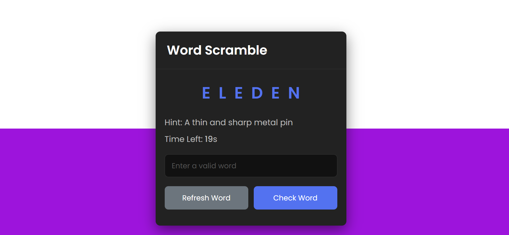

# 🎮 Word Scramble-Game

<p align="center">
  
  
  
  
</p>

<p align="center">
  <strong>🔤 Unscramble the letters. Challenge your mind. Find the word!</strong>
</p>

<p align="center">
  A fun, interactive word puzzle game built with HTML, CSS, and vanilla JavaScript.
</p>

---

## ✨ About the Game

Word Scramble is a browser-based word puzzle game that challenges players to rearrange mixed-up letters and discover the correct word.

Whether you're looking for a quick mental challenge or a fun way to sharpen your vocabulary, this game brings a little puzzle-solving excitement to your browser.

## 🚀 Features

- 🔤 **Word puzzles** — unscramble letters to discover hidden words.
- 🎯 **Interactive gameplay** — enter your answers and test your guesses.
- 🎨 **Visual experience** — enjoy the game's interface and styling.
- ⚡ **Lightweight** — built with HTML, CSS, and vanilla JavaScript.
- 🌐 **Browser-based** — play without installing a desktop application.


## 🖥️ Preview

<p align="center">
  
</p>

## 🛠️ Built With

| Technology | Purpose |
|---|---|
| HTML5 | Page structure and game elements |
| CSS3 | Styling, layout, colors, and animations |
| JavaScript | Game logic and player interactions |

## 🎮 How to Play

1. Open the game in your browser.
2. Look at the scrambled letters.
3. Rearrange them mentally to discover the word.
4. Enter your guess.
5. Submit your answer and see if you got it right.
6. Keep playing and challenge yourself!

*Gameplay steps may vary depending on the implemented controls.*

## 💻 Run Locally

**1. Clone the repository**

```bash
git clone YOUR_GITHUB_REPOSITORY_URL
```

**2. Open the project folder**

```bash
cd YOUR_PROJECT_FOLDER
```

**3. Launch the game**

Open `index.html` in your browser.


## 📁 Project Structure

```text
word-scramble/
├── index.html
├── style.css
├── script.js
├── assets/images
│   └── wordscramble1.png
└── README.md
```

## 🔮 Future Improvements

Possible additions as the project evolves:

- ⏱️ Timed challenges
- 🏆 Score tracking and high scores
- 💡 Hints for difficult words
- 📈 Increasing difficulty levels
- 📱 Improved mobile experience
- 🔊 Sound effects and feedback
- 📚 Different word categories

## 🤝 Contributing

Suggestions, feedback, and improvements are welcome. Feel free to fork the repository and experiment with new features.
Find the full Game source code in Repositories. Happy Gaming :) 💯

- 🚀 [Explore All Repositories](https://github.com/marisapanashe01?tab=repositories)


---

<p align="center">
  <strong>🧠 Think smart. Find the word. Enjoy the challenge!</strong>
</p>
